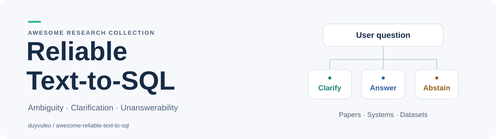

<!-- Generated by scripts/render.py from data/. Edit the catalog, then regenerate. -->
<picture>
  <source media="(prefers-color-scheme: dark)" srcset="assets/banner-dark.svg">
  
</picture>

# Awesome Reliable Text-to-SQL

> Curated papers, systems, and datasets for Text-to-SQL that can recognize ambiguity, ask useful questions, and decline unsupported requests.

Natural-language questions do not always determine one SQL query, and a database cannot answer every request. This collection focuses on how NL2SQL agents detect these situations, resolve them through interaction or additional evidence, and evaluate when to answer or abstain.

[**Explore the interactive catalog →**](https://duyvuleo.github.io/awesome-reliable-text-to-sql/) · [Browse papers](papers/README.md) · [Compare benchmarks](docs/benchmark-matrix.md) · [Try the examples](examples/README.md) · [Contribute](CONTRIBUTING.md)

Updated **2026-11-06**. Each paper includes a concise summary, publication status, public sources, and a verification date. Core work and adjacent methods are marked separately. Resource counts include clearly labeled benchmark designs whose artifacts are not yet verified released.

## Contents

- [Interactive explorer](#interactive-explorer)
- [Start here](#start-here)
- [Choose a reading route](#choose-a-reading-route)
- [Worked examples](examples/README.md)
- [Papers](papers/README.md)
- [Papers by year](papers/by-year.md)
- [Systems and tools](systems/README.md)
- [Datasets and benchmarks](datasets/README.md)
- [Benchmark selection matrix](docs/benchmark-matrix.md)
- [Evaluation guide](docs/evaluation.md)
- [Recent additions](#recent-additions)
- [Search method and coverage](docs/search-method.md)
- [Contributing](CONTRIBUTING.md)
- [Related collections](#related-collections)
- [Citation](#citation)

## Interactive explorer

### [Open the collection explorer →](https://duyvuleo.github.io/awesome-reliable-text-to-sql/)

Explore the catalog through a **clickable theme cloud, relationship graph, and searchable reading table**. Filter by resource type, paper year, research area, or code/tool link; inspect original sources and benchmark coverage; share a filtered URL or export a reading selection as JSON.

The explorer updates from the same catalog as these Markdown tables. Select multiple themes with any/all matching. Graph connections represent shared topics, not inferred citations; explicit paper–resource links remain in work details.

[Reader guide](docs/explorer.md) · [How it is built](docs/explorer-development.md)

## Start here

- **Understand the problem:** [Run three small SQLite examples](examples/README.md) covering ambiguity, unsupported requests, and valid empty results.
- **Explore the research:** Use the [interactive explorer](https://duyvuleo.github.io/awesome-reliable-text-to-sql/) or browse annotated papers [by topic](papers/README.md) or [by year](papers/by-year.md).
- **Plan an evaluation:** Use the [benchmark selection matrix](docs/benchmark-matrix.md), then check [datasets and access conditions](datasets/README.md).

## Choose a reading route

| Your question | Where to start |
| --- | --- |
| Can a request have several valid interpretations? | [Ambiguity and disambiguation](papers/README.md#ambiguity) |
| When should the system decline to generate SQL? | [Answerability and abstention](papers/README.md#answerability) |
| What should an agent ask, and when should it stop asking? | [Clarification and interaction](papers/README.md#interaction) |
| What changes when context spans documents, databases, or turns? | [Context and grounding](papers/README.md#context) |
| How do we test confidence and distinguish queries that happen to agree? | [Verification and uncertainty](papers/README.md#verification) |
| What can I actually run or download? | [Systems](systems/README.md) and [datasets](datasets/README.md), with availability notes |
| Which benchmark fits my experiment? | [Benchmark selection matrix](docs/benchmark-matrix.md) |
| What was published in a particular year? | [Papers by year](papers/by-year.md) and [datasets grouped by paper year](datasets/README.md#all-datasets-and-benchmarks) |
| How do ambiguity, unsupported information, and an empty answer differ? | [Three runnable SQLite walkthroughs](examples/README.md) |

## Scope

We include work that directly studies ambiguity, underspecification, answerability, clarification, or abstention in natural-language querying of relational databases. We also include selected verification, uncertainty, and contextual-grounding methods when their relevance to those problems is explicit. Generic SQL-generation systems and broad agent frameworks belong in the related collections unless they provide a concrete capability relevant to this scope.

An ambiguous request, an unsupported request, a model error, and a valid query returning no rows are different cases. Likewise, a publication, an announced repository, released artifacts, and independently reproduced results are different kinds of evidence. The annotations preserve these distinctions; inclusion is not a deployment endorsement.

## Recent additions

| Year | Paper / venue | Concise summary | Code / data |
| --- | --- | --- | --- |
| 2026 | [Auditing and Repairing LLM-as-Judge Failures in a Production Text-to-SQL Pipeline](papers/README.md#synca-audit) EMNLP 2026 Industry Track <em>adjacent</em> | Audits SQL-faithfulness judges against human labels, compares replacements and routes judge disagreements to review. It separates disagreement-enriched samples from random spot-checks, showing why aggregate agreement depends on sampling and domain. Evidence comes from one telecom deployment with limited cross-domain checks; the small head-to-head comparison is inconclusive and gold labels remain tied to the annotation protocol. | [Code](https://github.com/JamesL404/synca-audit) [Details](papers/README.md#synca-audit) |
| 2026 | [Text-to-SQL Models Make Choices Without Saying So](papers/README.md#specbridge) arXiv preprint <em>core</em> | SpecBridge pairs an open calculation request with two explicitly specified readings to separate computing an answer from reporting alternatives. It also evaluates deciding which readings to answer and preserving constraints after a user pick. Tests cover one choice and two reference readings at a time; simulated users recognize their intended reading, and product baselines are reconstructions rather than live-product evaluations. | [Code](https://github.com/Xyc-arch/specbridge-artifact) · [Data](https://github.com/Xyc-arch/specbridge-artifact/tree/main/benchmark) [Details](papers/README.md#specbridge) |
| 2026 | [Post-SQLFix: Property-Guided Repair of LLM-Generated SQL with Runtime Verification](papers/README.md#post-sqlfix) arXiv preprint <em>adjacent</em> | Combines dialect-aware static diagnostics with a monitor that accepts SQL repairs only when they reduce detected violations and respect declared operator contracts. Its bounded guarantees concern the specified rule family and protected query components. They do not establish equivalence to a gold query, preservation of unstated user intent or complete detection of semantic errors. | Release not verified [Details](papers/README.md#post-sqlfix) |
| 2026 | [Verifying Text-to-SQL Queries under Changing Business Semantics](papers/README.md#changing-business-semantics) arXiv preprint <em>adjacent</em> | Revalidates fixed SQL against an explicitly selected business-definition revision and knowledge cutoff using legal counterexample data. A discrepancy can expose stale semantics even when current-snapshot results agree. Evidence is limited to authored revision families and local model outputs; passing a finite test suite does not establish unrestricted conformance, and the approved definitions remain an external assumption. | Release not verified [Details](papers/README.md#changing-business-semantics) |
| 2026 | [When the Bottleneck Shifts: Diagnosing and Closing Information Gaps in Interactive Text-to-SQL](papers/README.md#pascal) EMNLP 2026 <em>core</em> | PASCAL routes schema inspection, knowledge retrieval and user clarification before SQL generation, guided by information gaps and interaction costs. BIRD-Interact experiments examine whether targeted acquisition reduces premature SQL attempts. Results depend on the benchmark user simulator, available tools and budgets; acquiring the required evidence does not itself guarantee correct SQL. | [Code](https://github.com/authurlord/PASCAL_Release) [Details](papers/README.md#pascal) |
| 2026 | [Can LLM Agents Be Forward-Deployed Engineers? Requirement Discovery and Delivery for Enterprise Text-to-SQL](papers/README.md#fde-requirement-discovery) arXiv preprint <em>adjacent</em> | Examines agents that elicit hidden customer requirements before planning and executing Text-to-SQL post-training. It separates discovery completeness from delivery acceptance under deployment constraints. Evidence comes from one enterprise engagement with a simulated customer, so it concerns requirement clarification and workflow delivery rather than general query-level ambiguity resolution or a universal agent success rate. | Release not verified [Details](papers/README.md#fde-requirement-discovery) |
| 2026 | [Conversational Interaction for LLM-Based Clinical Text-to-SQL: A User Study with Healthcare Professionals](papers/README.md#clinical-conversational-user-study) arXiv preprint <em>core</em> | Compares single-turn and conversational interfaces with 14 physicians, with dialogue analysis additionally pooling pilot participants. Users favor conversation, and freely composed questions trigger more clarification than predefined questions. The small cohort and MIMIC-IV Demo setting limit generalization; usability and perceived trust do not establish clinical accuracy or deployment safety. | Release not verified [Details](papers/README.md#clinical-conversational-user-study) |
| 2025 | [SQLens: An End-to-End Framework for Error Detection and Correction in Text-to-SQL](papers/README.md#sqlens) NeurIPS 2025 <em>adjacent</em> | Aggregates database and LLM error signals with weak supervision to localize clause-level semantic errors and guide sequential repairs. BIRD and Spider experiments support offline debugging, with incomplete detection and failed LLM repairs remaining. The authors position its computational overhead outside latency-sensitive pipelines; detection and repair are not guarantees of request answerability or semantic correctness. | Release not verified [Details](papers/README.md#sqlens) |

See the [changelog](CHANGELOG.md) for material changes and the [dated search records](docs/search-log/README.md) for coverage and unresolved leads. This is a living curated collection, not a claim of complete literature coverage.

## Contributing

Suggest a resource or correction through an [issue](https://github.com/duyvuleo/awesome-reliable-text-to-sql/issues/new/choose) or pull request. Include a primary source and explain the connection to ambiguity or unanswerability. See [CONTRIBUTING.md](CONTRIBUTING.md) for the entry format and checks.

The canonical records are [papers.json](data/papers.json) and [resources.json](data/resources.json). The indexes are generated, so contributors only need to maintain one record per work.

## Related collections

- [Awesome Text2SQL](https://github.com/eosphoros-ai/Awesome-Text2SQL) — Broader Text-to-SQL papers, benchmarks, and tooling.
- [NL2SQL Handbook](https://github.com/HKUSTDial/NL2SQL_Handbook) — A broader research and engineering reference.
- [Awesome AI Co-Scientist](https://github.com/duyvuleo/awesome-ai-co-scientist) — A companion annotated collection for agentic scientific discovery.
- [Awesome](https://github.com/sindresorhus/awesome) — Community guidance for curated lists. The badge identifies the list format; it does not assert inclusion in the central index.

## Citation

If you use this collection, please cite **Cong Duy Vu Hoang, *Awesome Reliable Text-to-SQL***. See [CITATION.cff](CITATION.cff) for machine-readable citation metadata.

## License

Original annotations, catalog records, and maintenance code in this repository are dedicated under [CC0 1.0](LICENSE). Linked papers, software, and datasets retain their own licenses and access conditions. No third-party papers or datasets are redistributed here.
