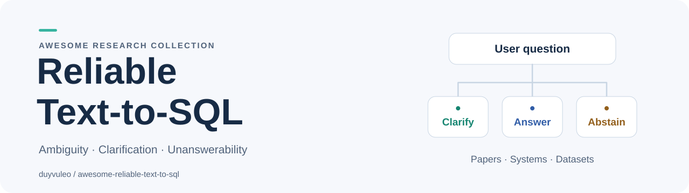

<!-- Generated by scripts/render.py from data/. Edit the catalog, then regenerate. -->
<picture>
  <source media="(prefers-color-scheme: dark)" srcset="assets/banner-dark.svg">
  
</picture>

# Awesome Reliable Text-to-SQL

> Curated papers, systems, and datasets for Text-to-SQL that can recognize ambiguity, ask useful questions, and decline unsupported requests.

Natural-language questions do not always determine one SQL query, and a database cannot answer every request. This collection focuses on how NL2SQL agents detect these situations, resolve them through interaction or additional evidence, and evaluate when to answer or abstain.

[Browse papers](papers/README.md) · [Compare benchmarks](docs/benchmark-matrix.md) · [Try the examples](examples/README.md) · [Contribute](CONTRIBUTING.md)

**62 annotated papers · 23 systems and tools · 25 dataset/benchmark entries**

Updated **2026-10-22**. Each paper includes a concise summary, publication status, public sources, and a verification date. Core work and adjacent methods are marked separately. Resource counts include clearly labeled benchmark designs whose artifacts are not yet verified released.

## Contents

- [Start here](#start-here)
- [Choose a reading route](#choose-a-reading-route)
- [Worked examples](examples/README.md)
- [Papers](papers/README.md)
- [Papers by year](papers/by-year.md)
- [Systems and tools](systems/README.md)
- [Datasets and benchmarks](datasets/README.md)
- [Benchmark selection matrix](docs/benchmark-matrix.md)
- [Evaluation guide](docs/evaluation.md)
- [Recent additions](#recent-additions)
- [Search method and coverage](docs/search-method.md)
- [Contributing](CONTRIBUTING.md)
- [Related collections](#related-collections)

## Start here

| Year | Paper / venue | Concise summary | Code / data |
| --- | --- | --- | --- |
| 2026 | [ABISS: Evaluating Text-to-SQL Systems Through Agent Interaction](papers/README.md#abiss) arXiv preprint <em>core</em> | Builds taxonomy-conditioned questions and evaluates SQL agents through multi-turn conversations with style-aware simulated users. Its model-council validation approximates unanswerability rather than proving it, and the controlled simulator does not establish performance with real users. | Release not verified [Details](papers/README.md#abiss) |
| 2026 | [CLARITY: A Framework and Benchmark for Conversational Language Ambiguity and Unanswerability in Interactive NL2SQL Systems](papers/README.md#clarity) ACL 2026 Industry Track <em>core</em> | Generates questions with interacting ambiguity or unanswerability sources, schema-grounded diagnostic metadata, and helpful, partial or unhelpful conversational continuations. Spider and BIRD experiments test detection, localization and resolution under these constructed settings; they do not establish live-user or production performance. | [Code](https://github.com/duyvuleo/clarity) · [Data](https://github.com/duyvuleo/clarity/tree/main/data) [Details](papers/README.md#clarity) |
| 2023 | [Benchmarking and Improving Text-to-SQL Generation under Ambiguity](papers/README.md#ambiqt) EMNLP 2023 <em>core</em> | Introduces AmbiQT, where one question supports two plausible SQL readings, and LogicalBeam, which diversifies query plans before schema-constrained infilling. The benchmark measures coverage of controlled lexical and structural alternatives rather than a complete interactive clarification policy. | [Code](https://github.com/tomartushar/AmbiQT) · [Data](https://github.com/tomartushar/AmbiQT/tree/master/benchmark) [Details](papers/README.md#ambiqt) |
| 2025 | [PRACTIQ: A Practical Conversational Text-to-SQL dataset with Ambiguous and Unanswerable Queries](papers/README.md#practiq) NAACL 2025 <em>core</em> | Constructs four-turn conversations across ambiguous and unanswerable question categories, including clarification and a clarified SQL answer. Its baselines classify question type and predict SQL with supplied clarification, which differs from evaluating an agent that must conduct its own dialogue. | [Code](https://github.com/amazon-science/conversational-ambiguous-unanswerable-text2sql) [Details](papers/README.md#practiq) |
| 2024 | [TrustSQL: Benchmarking Text-to-SQL Reliability with Penalty-Based Scoring](papers/README.md#trustsql) arXiv preprint <em>core</em> | Evaluates systems that answer feasible questions correctly and abstain on infeasible questions, using a reliability score with configurable penalties for errors. Results depend on the selected penalty and question distribution, and should not be compared directly with execution accuracy on answerable-only benchmarks. | [Code](https://github.com/glee4810/TrustSQL) · [Data](https://github.com/glee4810/TrustSQL#dataset) [Details](papers/README.md#trustsql) |
| 2019 | [CoSQL: A Conversational Text-to-SQL Challenge Towards Cross-Domain Natural Language Interfaces to Databases](papers/README.md#cosql) EMNLP-IJCNLP 2019 <em>core</em> | Collects Wizard-of-Oz conversations in which SQL experts answer database questions, clarify ambiguities, and identify unanswerable or unrelated requests. It provides foundational dialogue-act and response-generation tasks, but standard SQL state tracking consumes recorded conversation context rather than testing an autonomous live clarification policy. | [Code](https://github.com/taoyds/cosql) · [Data](https://yale-lily.github.io/cosql) [Details](papers/README.md#cosql) |

## Choose a reading route

| Your question | Where to start |
| --- | --- |
| Can a request have several valid interpretations? | [Ambiguity and disambiguation](papers/README.md#ambiguity) |
| When should the system decline to generate SQL? | [Answerability and abstention](papers/README.md#answerability) |
| What should an agent ask, and when should it stop asking? | [Clarification and interaction](papers/README.md#interaction) |
| What changes when context spans documents, databases, or turns? | [Context and grounding](papers/README.md#context) |
| How do we test confidence and distinguish queries that happen to agree? | [Verification and uncertainty](papers/README.md#verification) |
| What can I actually run or download? | [Systems](systems/README.md) and [datasets](datasets/README.md), with availability notes |
| Which benchmark fits my experiment? | [Benchmark selection matrix](docs/benchmark-matrix.md) |
| What was published in a particular year? | [Papers by year](papers/by-year.md) and [datasets grouped by paper year](datasets/README.md#all-datasets-and-benchmarks) |
| How do ambiguity, unsupported information, and an empty answer differ? | [Three runnable SQLite walkthroughs](examples/README.md) |

## Scope

We include work that directly studies ambiguity, underspecification, answerability, clarification, or abstention in natural-language querying of relational databases. We also include selected verification, uncertainty, and contextual-grounding methods when their relevance to those problems is explicit. Generic SQL-generation systems and broad agent frameworks belong in the related collections unless they provide a concrete capability relevant to this scope.

An ambiguous request, an unsupported request, a model error, and a valid query returning no rows are different cases. Likewise, a publication, an announced repository, released artifacts, and independently reproduced results are different kinds of evidence. The annotations preserve these distinctions; inclusion is not a deployment endorsement.

## Recent additions

| Year | Paper / venue | Concise summary | Code / data |
| --- | --- | --- | --- |
| 2026 | [ABISS: Evaluating Text-to-SQL Systems Through Agent Interaction](papers/README.md#abiss) arXiv preprint <em>core</em> | Builds taxonomy-conditioned questions and evaluates SQL agents through multi-turn conversations with style-aware simulated users. Its model-council validation approximates unanswerability rather than proving it, and the controlled simulator does not establish performance with real users. | Release not verified [Details](papers/README.md#abiss) |
| 2026 | [AmbiSQL: Interactive Ambiguity Detection and Resolution for Text-to-SQL](papers/README.md#ambisql) SIGMOD 2026 demonstration described in author manuscript; first preprint 2025 <em>core</em> | Detects ambiguous phrases, presents multiple-choice clarification options, and rewrites the question before passing it to a SQL generator. The demonstration integrates XiYan-SQL and a small set of ambiguous examples, so its interface and detection mechanisms should be separated from claims of general end-to-end reliability. | [Code](https://github.com/JustinzjDing/AmbiSQL) [Details](papers/README.md#ambisql) |
| 2026 | [ARCS: Towards Precise Text-to-SQL via Structured Disambiguation](papers/README.md#arcs) arXiv preprint <em>core</em> | Introduces structured selection among ambiguity points and interpretations, with a corpus built over real-world databases. The benchmark separates disambiguation from SQL generation and uses a user simulator, so its reported results remain specific to the annotated alternatives and interaction protocol. | [Code](https://github.com/megagonlabs/tabulaflow) · [Data](https://huggingface.co/datasets/megagonlabs/arcs) [Details](papers/README.md#arcs) |
| 2026 | [Beyond Correctness: Resolving Underspecification in Agentic Text-to-SQL](papers/README.md#planpool) arXiv preprint <em>core</em> | PlanPool stores clarification questions in an explicit mutable pool, requiring each planned question to be asked or deliberately dropped before SQL submission. Experiments on BIRD-Interact- and Spider-derived tasks distinguish ambiguity coverage from execution correctness, but do not guarantee that the initial pool captures every missing constraint. | Release not verified [Details](papers/README.md#planpool) |
| 2026 | [BIRD-INTERACT: Re-imagining Text-to-SQL Evaluation for Large Language Models via Lens of Dynamic Interactions](papers/README.md#bird-interact) ICLR 2026 oral; first preprint 2025 <em>core</em> | Combines database documentation, hierarchical business knowledge, executable tests, and a function-driven user simulator to evaluate conversational and autonomous agent interaction across ambiguous CRUD tasks. Its Full and Lite tasks measure success within a specified simulator and action budget; they do not establish that an assistant has resolved every real user&#x27;s intent. | [Code](https://github.com/bird-bench/BIRD-Interact) · [Data](https://huggingface.co/datasets/birdsql/bird-interact-full) [Details](papers/README.md#bird-interact) |
| 2026 | [Certified Against Which Oracle? Execution Labels Set the Reported Risk of Conformal Abstention for Text-to-SQL](papers/README.md#oracle-abstention) arXiv preprint <em>core</em> | Audits conformal abstention by changing the database-based oracle used to cluster SQL candidates and label correctness, then comparing with expert judgments. The study shows why reported risk must be interpreted relative to the oracle and benchmark quality, rather than treated as an unconditional semantic guarantee. | Release not verified [Details](papers/README.md#oracle-abstention) |
| 2026 | [CLARITY: A Framework and Benchmark for Conversational Language Ambiguity and Unanswerability in Interactive NL2SQL Systems](papers/README.md#clarity) ACL 2026 Industry Track <em>core</em> | Generates questions with interacting ambiguity or unanswerability sources, schema-grounded diagnostic metadata, and helpful, partial or unhelpful conversational continuations. Spider and BIRD experiments test detection, localization and resolution under these constructed settings; they do not establish live-user or production performance. | [Code](https://github.com/duyvuleo/clarity) · [Data](https://github.com/duyvuleo/clarity/tree/main/data) [Details](papers/README.md#clarity) |
| 2026 | [Confidence Estimation for Text-to-SQL in Large Language Models](papers/README.md#confidence-llms) AAAI 2026 <em>adjacent</em> | Studies black-box consistency signals and white-box SQL-aware confidence estimates, including execution-based grounding. The work estimates reliability without gold answers at inference time; a confidence score alone does not determine whether the user&#x27;s request is ambiguous or unsupported. | Release not verified [Details](papers/README.md#confidence-llms) |

See the [changelog](CHANGELOG.md) for material changes and the [dated search records](docs/search-log/README.md) for coverage and unresolved leads. This is a living curated collection, not a claim of complete literature coverage.

## Contributing

Suggest a resource or correction through an [issue](https://github.com/duyvuleo/awesome-reliable-text-to-sql/issues/new/choose) or pull request. Include a primary source and explain the connection to ambiguity or unanswerability. See [CONTRIBUTING.md](CONTRIBUTING.md) for the entry format and checks.

The canonical records are [papers.json](data/papers.json) and [resources.json](data/resources.json). The indexes are generated, so contributors only need to maintain one record per work.

## Related collections

- [Awesome Text2SQL](https://github.com/eosphoros-ai/Awesome-Text2SQL) — Broader Text-to-SQL papers, benchmarks, and tooling.
- [NL2SQL Handbook](https://github.com/HKUSTDial/NL2SQL_Handbook) — A broader research and engineering reference.
- [Awesome AI Co-Scientist](https://github.com/duyvuleo/awesome-ai-co-scientist) — A companion annotated collection for agentic scientific discovery.
- [Awesome](https://github.com/sindresorhus/awesome) — Community guidance for curated lists. The badge identifies the list format; it does not assert inclusion in the central index.

## License

Original annotations, catalog records, and maintenance code in this repository are dedicated under [CC0 1.0](LICENSE). Linked papers, software, and datasets retain their own licenses and access conditions. No third-party papers or datasets are redistributed here.
