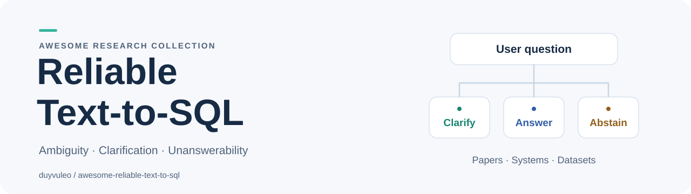

<!-- Generated by scripts/render.py from data/. Edit the catalog, then regenerate. -->
<picture>
  <source media="(prefers-color-scheme: dark)" srcset="assets/banner-dark.svg">
  
</picture>

# Awesome Reliable Text-to-SQL

> Curated papers, systems, and datasets for Text-to-SQL that can recognize ambiguity, ask useful questions, and decline unsupported requests.

Natural-language questions do not always determine one SQL query, and a database cannot answer every request. This collection focuses on how NL2SQL agents detect these situations, resolve them through interaction or additional evidence, and evaluate when to answer or abstain.

[**Explore the interactive catalog →**](https://duyvuleo.github.io/awesome-reliable-text-to-sql/) · [Browse papers](papers/README.md) · [Compare benchmarks](docs/benchmark-matrix.md) · [Try the examples](examples/README.md) · [Contribute](CONTRIBUTING.md)

Updated **2026-11-18**. Each paper includes a concise summary, publication status, public sources, and a verification date. Core work and adjacent methods are marked separately. Resource counts include clearly labeled benchmark designs whose artifacts are not yet verified released.

[**Read the detailed paper notes →**](papers/reading-notes.md) for methods, evaluation conditions, findings, limitations and checks against the original text. The index records completed readings and remaining access gaps.

## Contents

- [Interactive explorer](#interactive-explorer)
- [Start here](#start-here)
- [Choose a reading route](#choose-a-reading-route)
- [Worked examples](examples/README.md)
- [Papers](papers/README.md)
- [Papers by year](papers/by-year.md)
- [Detailed paper notes](papers/reading-notes.md)
- [Systems and tools](systems/README.md)
- [Datasets and benchmarks](datasets/README.md)
- [Benchmark selection matrix](docs/benchmark-matrix.md)
- [Evaluation guide](docs/evaluation.md)
- [Recent additions](#recent-additions)
- [Search method and coverage](docs/search-method.md)
- [Contributing](CONTRIBUTING.md)
- [Related collections](#related-collections)
- [Citation](#citation)

## Interactive explorer

### [Open the collection explorer →](https://duyvuleo.github.io/awesome-reliable-text-to-sql/)

Explore the catalog through a **clickable theme cloud, relationship graph, and searchable reading table**. Filter by resource type, paper year, research area, or code/tool link; inspect original sources and benchmark coverage; share a filtered URL or export a reading selection as JSON.

The explorer updates from the same catalog as these Markdown tables. Select multiple themes with any/all matching. Graph connections represent shared topics, not inferred citations; explicit paper–resource links remain in work details.

[Reader guide](docs/explorer.md) · [How it is built](docs/explorer-development.md)

## Start here

- **Understand the problem:** [Run three small SQLite examples](examples/README.md) covering ambiguity, unsupported requests, and valid empty results.
- **Explore the research:** Use the [interactive explorer](https://duyvuleo.github.io/awesome-reliable-text-to-sql/) or browse annotated papers [by topic](papers/README.md) or [by year](papers/by-year.md).
- **Plan an evaluation:** Use the [benchmark selection matrix](docs/benchmark-matrix.md), then check [datasets and access conditions](datasets/README.md).

## Choose a reading route

| Your question | Where to start |
| --- | --- |
| Can a request have several valid interpretations? | [Ambiguity and disambiguation](papers/README.md#ambiguity) |
| When should the system decline to generate SQL? | [Answerability and abstention](papers/README.md#answerability) |
| What should an agent ask, and when should it stop asking? | [Clarification and interaction](papers/README.md#interaction) |
| What changes when context spans documents, databases, or turns? | [Context and grounding](papers/README.md#context) |
| How do we test confidence and distinguish queries that happen to agree? | [Verification and uncertainty](papers/README.md#verification) |
| What can I actually run or download? | [Systems](systems/README.md) and [datasets](datasets/README.md), with availability notes |
| Which benchmark fits my experiment? | [Benchmark selection matrix](docs/benchmark-matrix.md) |
| What was published in a particular year? | [Papers by year](papers/by-year.md) and [datasets grouped by paper year](datasets/README.md#all-datasets-and-benchmarks) |
| How do ambiguity, unsupported information, and an empty answer differ? | [Three runnable SQLite walkthroughs](examples/README.md) |

## Scope

We include work that directly studies ambiguity, underspecification, answerability, clarification, or abstention in natural-language querying of relational databases. We also include selected verification, uncertainty, and contextual-grounding methods when their relevance to those problems is explicit. Generic SQL-generation systems and broad agent frameworks belong in the related collections unless they provide a concrete capability relevant to this scope.

An ambiguous request, an unsupported request, a model error, and a valid query returning no rows are different cases. Likewise, a publication, an announced repository, released artifacts, and independently reproduced results are different kinds of evidence. The annotations preserve these distinctions; inclusion is not a deployment endorsement.

## Recent additions

| Year | Paper / venue | Concise summary | Links |
| --- | --- | --- | --- |
| 2026 | [Living Context Graphs: Continual Semantic Learning for Enterprise Data Reasoning](papers/README.md#living-context-graphs) arXiv preprint; CL4FMAgents at NeurIPS 2026 acceptance reported by authors <em>adjacent</em> | Learns reusable business definitions and conventions from answer-verified SQL outcomes, filters proposed rules before admission, and gates graph routes with outcome signals. A selected three-database study separates admission-driven transfer gains from graph-routing efficiency. Gold-answer supervision, a model-based admission judge and single-run checkpoint observations limit claims about production feedback or reliable forgetting. Only split/fact-family annotations are released; the pipeline is not. | [Data](https://github.com/varunagrawal2002/Living-Context-Graph) [Details](papers/README.md#living-context-graphs) [Reading notes](https://github.com/duyvuleo/awesome-reliable-text-to-sql/blob/main/papers/notes/living-context-graphs.md) |
| 2026 | [Optimizing Query Decomposition for Reliable Validation](papers/README.md#decoval) arXiv preprint; v1, 16 November 2026; PDF venue fields are placeholders <em>adjacent</em> | DecoVal chooses a semantics-preserving decomposition of a candidate SQL query for blockwise human or LLM validation. A small human study and 305-candidate evaluation show improved error detection, with time and false-rejection trade-offs. Optimality applies to a restricted search space and modeled cost; fallible LLM-written requirements and execution-based labels do not establish intent correctness or calibrated risk. | [Code](https://github.com/Inverse0/validation-aware-decomposition) · [Data](https://github.com/Inverse0/validation-aware-decomposition/tree/a1aacc8b554749768544025fbafb569543c0562d/benchmarks/validation) [Details](papers/README.md#decoval) [Reading notes](https://github.com/duyvuleo/awesome-reliable-text-to-sql/blob/main/papers/notes/decoval.md) |
| 2024 | [LG AI Research &amp; KAIST at EHRSQL 2024: Self-Training Large Language Models with Pseudo-Labeled Unanswerable Questions for a Reliable Text-to-SQL System on EHRs](papers/README.md#pluq) ClinicalNLP 2024 shared-task paper, pp. 635–643 <em>core</em> | PLUQ retrains a SQL model using questions it labels unanswerable in the development/test pool, then filters outputs by maximum token entropy and execution outcomes. Results concern transductive EHRSQL adaptation and penalty-based scoring, not unseen-query or clinical safety guarantees. Entropy and empty-result filters can reject answerable requests; the published ablations do not isolate the self-training contribution. | Release not verified [Details](papers/README.md#pluq) [Reading notes](https://github.com/duyvuleo/awesome-reliable-text-to-sql/blob/main/papers/notes/pluq.md) |
| 2021 | [DIY: Assessing the Correctness of Natural Language to SQL Systems](papers/README.md#diy) IUI 2021; pages 597–607 <em>adjacent</em> | DIY lets users inspect SQL behavior on small sample databases, test counterfactual rows and correct question-to-query mappings. A 12-person exploratory study identifies debugging strategies and confusion between sample and full-data answers. It reports usability observations, not controlled accuracy or speed gains; recognizing ambiguity did not consistently lead to correction, and answerability was not evaluated. | Release not verified [Details](papers/README.md#diy) [Reading notes](https://github.com/duyvuleo/awesome-reliable-text-to-sql/blob/main/papers/notes/diy.md) |
| 2026 | [Bridge: Database-Grounded Interactive Disambiguation for Text-to-SQL](papers/README.md#bridge-disambiguation) arXiv preprint <em>core</em> | Builds an offline column-ambiguity graph and value-similarity index to retrieve alternatives around an initially rejected SQL query, then asks a first-turn clarification batch before continuing a Sphinteract-style loop. Evaluation uses a gold-informed simulated user and single-reference BIRD execution matching. Reported token savings exclude user simulation; offline construction and incomplete released reproduction inputs require separate accounting. | [Code](https://github.com/slyipae1/BRIDGE) [Details](papers/README.md#bridge-disambiguation) [Reading notes](https://github.com/duyvuleo/awesome-reliable-text-to-sql/blob/main/papers/notes/bridge-disambiguation.md) |
| 2026 | [LuthorSQL: A One-Pass Text-to-SQL Model as System 1 for a Slower LLM Agent](papers/README.md#luthorsql) arXiv preprint <em>adjacent</em> | Uses a bounded-plan generator and learned SQL validator to keep high-margin answers local and defer other requests to a tool-using LLM. Evaluates cost versus reference execution agreement across several routing settings. Margin scores are not calibrated answerability; savings depend on handoff and compute accounting, some runs lose accuracy, and development-set reuse limits generalization claims. | [Code](https://github.com/IAMIbrahimmemon/luthorsql) · [Data](https://huggingface.co/datasets/IAMIbrahim/luthorsql-fresh-unseen) [Details](papers/README.md#luthorsql) [Reading notes](https://github.com/duyvuleo/awesome-reliable-text-to-sql/blob/main/papers/notes/luthorsql.md) |
| 2026 | [Role-Conditioned Refusals: Evaluating Access Control Reasoning in Large Language Models](papers/README.md#role-conditioned-refusals) Findings of EACL 2026; first preprint October 2025 <em>adjacent</em> | Augments Spider and BIRD with role policies to compare direct SQL-or-refuse prompting, an LLM generator/verifier and LoRA training. Verification often improves refusal metrics, while transfer and longer policies remain difficult. These are authorization decisions, not intrinsic unanswerability or guaranteed enforcement. Released Spider labeling normalizes all execution errors to denial; BIRD documents privilege-specific filtering. | [Code](https://github.com/klisura-code/LLM-Access-Control-Datasets) · [Data](https://github.com/klisura-code/LLM-Access-Control-Datasets/tree/9179b2ec6d84df56803cbbeb2650cd86b7c1b56f/data) [Details](papers/README.md#role-conditioned-refusals) [Reading notes](https://github.com/duyvuleo/awesome-reliable-text-to-sql/blob/main/papers/notes/role-conditioned-refusals.md) |
| 2023 | [Interactive Text-to-SQL Generation via Editable Step-by-Step Explanations](papers/README.md#steps) EMNLP 2023; first preprint May 2023 <em>adjacent</em> | STEPS lets users repair SQL by editing clause-level explanations, combining direct entity transformations with a neural text-to-clause model. A 24-person study measures correction and effort. Its 97.9% simulated accuracy assumes perfect reference-aware feedback; real-user accuracy is conditional on completed tasks. It evaluates repair of single questions, not autonomous clarification or refusal. | [Code](https://github.com/magic-YuanTian/STEPS) [Details](papers/README.md#steps) [Reading notes](https://github.com/duyvuleo/awesome-reliable-text-to-sql/blob/main/papers/notes/steps.md) |

See the [changelog](CHANGELOG.md) for material changes and the [dated search records](docs/search-log/README.md) for coverage and unresolved leads. This is a living curated collection, not a claim of complete literature coverage.

## Contributing

Suggest a resource or correction through an [issue](https://github.com/duyvuleo/awesome-reliable-text-to-sql/issues/new/choose) or pull request. Include a primary source and explain the connection to ambiguity or unanswerability. See [CONTRIBUTING.md](CONTRIBUTING.md) for the entry format and checks.

The canonical records are [papers.json](data/papers.json) and [resources.json](data/resources.json). The indexes are generated, so contributors only need to maintain one record per work.

## Related collections

- [Awesome Text2SQL](https://github.com/eosphoros-ai/Awesome-Text2SQL) — Broader Text-to-SQL papers, benchmarks, and tooling.
- [NL2SQL Handbook](https://github.com/HKUSTDial/NL2SQL_Handbook) — A broader research and engineering reference.
- [Awesome AI Co-Scientist](https://github.com/duyvuleo/awesome-ai-co-scientist) — A companion annotated collection for agentic scientific discovery.
- [Awesome](https://github.com/sindresorhus/awesome) — Community guidance for curated lists. The badge identifies the list format; it does not assert inclusion in the central index.

## Citation

If you use this collection, please cite **Cong Duy Vu Hoang, *Awesome Reliable Text-to-SQL***. See [CITATION.cff](CITATION.cff) for machine-readable citation metadata.

## License

Original annotations, catalog records, and maintenance code in this repository are dedicated under [CC0 1.0](LICENSE). Linked papers, software, and datasets retain their own licenses and access conditions. No third-party papers or datasets are redistributed here.
